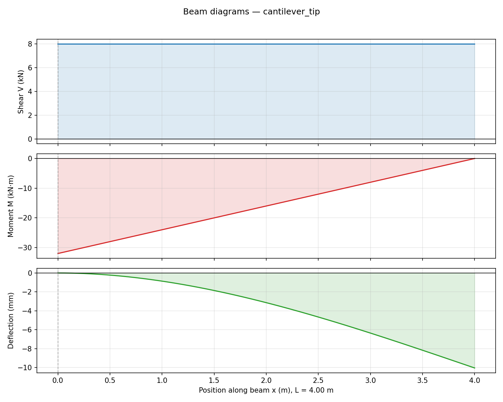

# Beam analysis report — cantilever_tip

Span L = 4.000 m; E = 200,000 MPa; Fy = 345 MPa.
Section: **W12x26** (Ix = 8,491.1 cm^4, Sx = 547.3 cm^3, source: AISC Steel Construction Manual, 16th Edition, Table 1-1).

## Supports and loads

| Support | x (m) | Type |
|---|---|---|
| S | 0.000 | fixed |

| Point load | x (m) | P (kN) |
|---|---|---|
| P | 4.000 | 8.000 |

## Reactions

| Support x (m) | Type | R vertical (kN) | M reaction (kN*m) |
|---|---|---|---|
| 0.000 | fixed | 8.000 | 32.000 |

Equilibrium check: force residual 7.42e-10 kN, moment residual -1.14e-08 kN*m.

## Key results

- Max shear: **8.000 kN** at x = 3.600 m
- Max bending moment: **-32.000 kN*m** at x = 0.000 m
- Min bending moment: **-32.000 kN*m** at x = 0.000 m
- Max downward deflection: **10.050 mm** at x = 4.000 m

## Stress checks

| Check | Demand | Allowable / capacity | Utilisation | Verdict |
|---|---|---|---|---|
| Bending stress | 58.47 MPa | 227.70 MPa | 0.257 | PASS |
| Shear stress | 4.41 MPa | 138.00 MPa | 0.032 | PASS |
| LRFD flexure | 32.00 kN*m | phi*Mn = 189.28 kN*m | 0.169 | PASS |
| Deflection | 10.05 mm | 11.11 mm (L/360) | 0.904 | PASS |

**Overall verdict: PASS**

## Diagram values (stations every 0.5 m)

| x (m) | V (kN) | M (kN*m) | delta (mm) |
|---|---|---|---|
| 0.00 | 8.000 | -32.000 | 0.000 |
| 0.50 | 8.000 | -28.000 | -0.226 |
| 1.00 | 8.000 | -24.000 | -0.864 |
| 1.50 | 8.000 | -20.000 | -1.855 |
| 2.00 | 8.000 | -16.000 | -3.141 |
| 2.50 | 8.000 | -12.000 | -4.662 |
| 3.00 | 8.000 | -8.000 | -6.360 |
| 3.50 | 8.000 | -4.000 | -8.175 |
| 4.00 | 8.000 | -0.000 | -10.050 |

> Sign convention: V and M follow dV/dx = -w and dM/dx = V, M positive when sagging. Deflection positive upward in the table; the reported maximum is the largest downward value. Euler-Bernoulli theory (no shear deformation).
