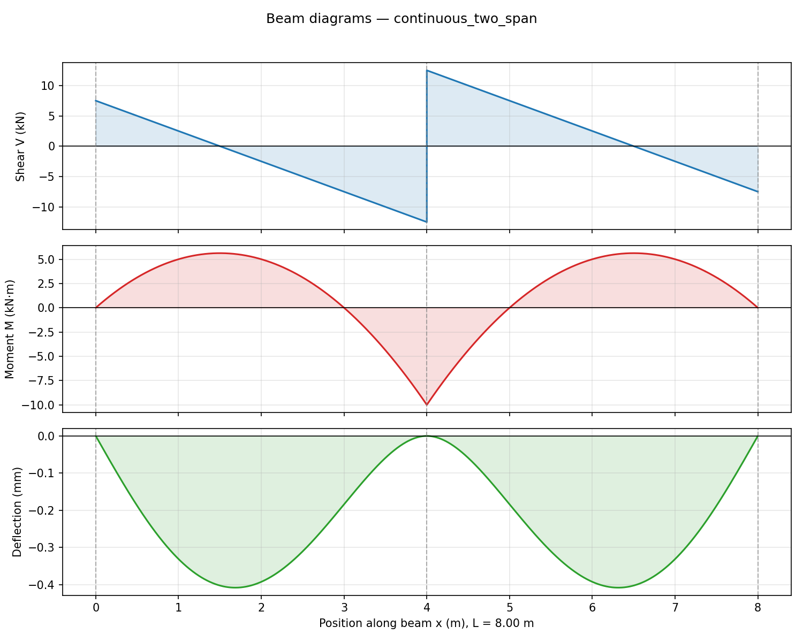

# Beam analysis report — continuous_two_span

Span L = 8.000 m; E = 200,000 MPa; Fy = 345 MPa.
Section: **W12x26** (Ix = 8,491.1 cm^4, Sx = 547.3 cm^3, source: AISC Steel Construction Manual, 16th Edition, Table 1-1).

## Supports and loads

| Support | x (m) | Type |
|---|---|---|
| S | 0.000 | pin |
| S | 4.000 | roller |
| S | 8.000 | roller |

| Distributed load | x1 (m) | x2 (m) | w1 (kN/m) | w2 (kN/m) |
|---|---|---|---|---|
| w | 0.000 | 8.000 | 5.000 | 5.000 |

## Reactions

| Support x (m) | Type | R vertical (kN) | M reaction (kN*m) |
|---|---|---|---|
| 0.000 | pin | 7.500 | 0.000 |
| 4.000 | roller | 25.000 | 0.000 |
| 8.000 | roller | 7.500 | 0.000 |

Equilibrium check: force residual 4.02e-12 kN, moment residual -1.48e-10 kN*m.

## Key results

- Max shear: **12.500 kN** at x = 4.000 m
- Max bending moment: **-10.000 kN*m** at x = 4.000 m
- Min bending moment: **-10.000 kN*m** at x = 4.000 m
- Max downward deflection: **0.408 mm** at x = 1.687 m

## Stress checks

| Check | Demand | Allowable / capacity | Utilisation | Verdict |
|---|---|---|---|---|
| Bending stress | 18.27 MPa | 227.70 MPa | 0.080 | PASS |
| Shear stress | 6.89 MPa | 138.00 MPa | 0.050 | PASS |
| LRFD flexure | 10.00 kN*m | phi*Mn = 189.28 kN*m | 0.053 | PASS |
| Deflection | 0.41 mm | 22.22 mm (L/360) | 0.018 | PASS |

**Overall verdict: PASS**

## Diagram values (stations every 0.5 m)

| x (m) | V (kN) | M (kN*m) | delta (mm) |
|---|---|---|---|
| 0.00 | 7.500 | -0.000 | 0.000 |
| 0.50 | 5.000 | 3.125 | -0.188 |
| 1.00 | 2.500 | 5.000 | -0.331 |
| 1.50 | 0.000 | 5.625 | -0.403 |
| 2.00 | -2.500 | 5.000 | -0.393 |
| 2.50 | -5.000 | 3.125 | -0.311 |
| 3.00 | -7.500 | 0.000 | -0.184 |
| 3.50 | -10.000 | -4.375 | -0.059 |
| 4.00 | -12.500 | -10.000 | 0.000 |
| 4.50 | 10.000 | -4.375 | -0.059 |
| 5.00 | 7.500 | 0.000 | -0.184 |
| 5.50 | 5.000 | 3.125 | -0.311 |
| 6.00 | 2.500 | 5.000 | -0.393 |
| 6.50 | 0.000 | 5.625 | -0.403 |
| 7.00 | -2.500 | 5.000 | -0.331 |
| 7.50 | -5.000 | 3.125 | -0.188 |
| 8.00 | -7.500 | -0.000 | 0.000 |

> Sign convention: V and M follow dV/dx = -w and dM/dx = V, M positive when sagging. Deflection positive upward in the table; the reported maximum is the largest downward value. Euler-Bernoulli theory (no shear deformation).
