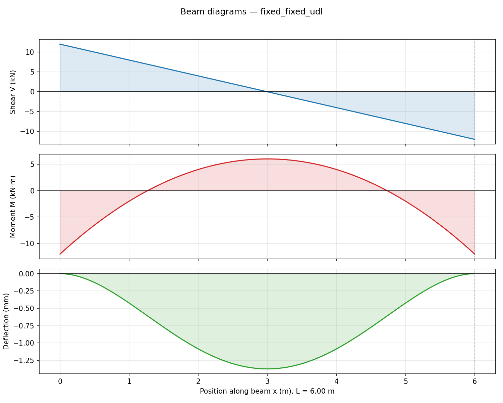

# Beam analysis report — fixed_fixed_udl

Span L = 6.000 m; E = 200,000 MPa; Fy = 345 MPa.
Section: **W10x22** (Ix = 4,911.5 cm^4, Sx = 380.2 cm^3, source: AISC Steel Construction Manual, 16th Edition, Table 1-1).

## Supports and loads

| Support | x (m) | Type |
|---|---|---|
| S | 0.000 | fixed |
| S | 6.000 | fixed |

| Distributed load | x1 (m) | x2 (m) | w1 (kN/m) | w2 (kN/m) |
|---|---|---|---|---|
| w | 0.000 | 6.000 | 4.000 | 4.000 |

## Reactions

| Support x (m) | Type | R vertical (kN) | M reaction (kN*m) |
|---|---|---|---|
| 0.000 | fixed | 12.000 | 12.000 |
| 6.000 | fixed | 12.000 | -12.000 |

Equilibrium check: force residual 1.82e-09 kN, moment residual 7.85e-09 kN*m.

## Key results

- Max shear: **12.000 kN** at x = 0.000 m
- Max bending moment: **-12.000 kN*m** at x = 6.000 m
- Min bending moment: **-12.000 kN*m** at x = 6.000 m
- Max downward deflection: **1.374 mm** at x = 3.000 m

## Stress checks

| Check | Demand | Allowable / capacity | Utilisation | Verdict |
|---|---|---|---|---|
| Bending stress | 31.56 MPa | 227.70 MPa | 0.139 | PASS |
| Shear stress | 7.62 MPa | 138.00 MPa | 0.055 | PASS |
| LRFD flexure | 12.00 kN*m | phi*Mn = 135.35 kN*m | 0.089 | PASS |
| Deflection | 1.37 mm | 16.67 mm (L/360) | 0.082 | PASS |

**Overall verdict: PASS**

## Diagram values (stations every 0.5 m)

| x (m) | V (kN) | M (kN*m) | delta (mm) |
|---|---|---|---|
| 0.00 | 12.000 | -12.000 | 0.000 |
| 0.50 | 10.000 | -6.500 | -0.128 |
| 1.00 | 8.000 | -2.000 | -0.424 |
| 1.50 | 6.000 | 1.500 | -0.773 |
| 2.00 | 4.000 | 4.000 | -1.086 |
| 2.50 | 2.000 | 5.500 | -1.299 |
| 3.00 | 0.000 | 6.000 | -1.374 |
| 3.50 | -2.000 | 5.500 | -1.299 |
| 4.00 | -4.000 | 4.000 | -1.086 |
| 4.50 | -6.000 | 1.500 | -0.773 |
| 5.00 | -8.000 | -2.000 | -0.424 |
| 5.50 | -10.000 | -6.500 | -0.128 |
| 6.00 | -12.000 | -12.000 | 0.000 |

> Sign convention: V and M follow dV/dx = -w and dM/dx = V, M positive when sagging. Deflection positive upward in the table; the reported maximum is the largest downward value. Euler-Bernoulli theory (no shear deformation).
