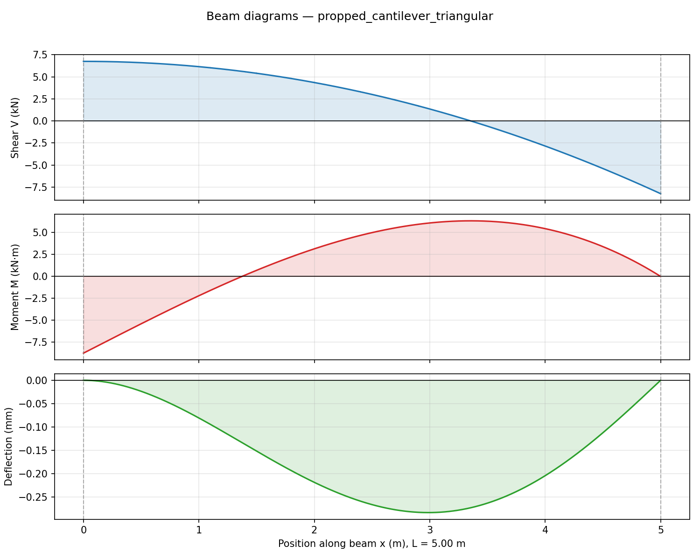

# Beam analysis report — propped_cantilever_triangular

Span L = 5.000 m; E = 200,000 MPa; Fy = 345 MPa.
Section: **W14x48** (Ix = 20,145.6 cm^4, Sx = 1,150.4 cm^3, source: AISC Steel Construction Manual, 16th Edition, Table 1-1).

## Supports and loads

| Support | x (m) | Type |
|---|---|---|
| S | 0.000 | fixed |
| S | 5.000 | roller |

| Distributed load | x1 (m) | x2 (m) | w1 (kN/m) | w2 (kN/m) |
|---|---|---|---|---|
| w | 0.000 | 5.000 | 0.000 | 6.000 |

## Reactions

| Support x (m) | Type | R vertical (kN) | M reaction (kN*m) |
|---|---|---|---|
| 0.000 | fixed | 6.750 | 8.750 |
| 5.000 | roller | 8.250 | 0.000 |

Equilibrium check: force residual 1.36e-09 kN, moment residual 4.94e-09 kN*m.

## Key results

- Max shear: **-8.250 kN** at x = 5.000 m
- Max bending moment: **-8.750 kN*m** at x = 0.000 m
- Min bending moment: **-8.750 kN*m** at x = 0.000 m
- Max downward deflection: **0.284 mm** at x = 2.987 m

## Stress checks

| Check | Demand | Allowable / capacity | Utilisation | Verdict |
|---|---|---|---|---|
| Bending stress | 7.61 MPa | 227.70 MPa | 0.033 | PASS |
| Shear stress | 2.73 MPa | 138.00 MPa | 0.020 | PASS |
| LRFD flexure | 8.75 kN*m | phi*Mn = 396.88 kN*m | 0.022 | PASS |
| Deflection | 0.28 mm | 13.89 mm (L/360) | 0.020 | PASS |

**Overall verdict: PASS**

## Diagram values (stations every 0.5 m)

| x (m) | V (kN) | M (kN*m) | delta (mm) |
|---|---|---|---|
| 0.00 | 6.750 | -8.750 | 0.000 |
| 0.50 | 6.600 | -5.400 | -0.024 |
| 1.00 | 6.150 | -2.200 | -0.081 |
| 1.50 | 5.400 | 0.700 | -0.152 |
| 2.00 | 4.350 | 3.150 | -0.219 |
| 2.50 | 3.000 | 5.000 | -0.267 |
| 3.00 | 1.350 | 6.100 | -0.284 |
| 3.50 | -0.600 | 6.300 | -0.263 |
| 4.00 | -2.850 | 5.450 | -0.205 |
| 4.50 | -5.400 | 3.400 | -0.112 |
| 5.00 | -8.250 | 0.000 | 0.000 |

> Sign convention: V and M follow dV/dx = -w and dM/dx = V, M positive when sagging. Deflection positive upward in the table; the reported maximum is the largest downward value. Euler-Bernoulli theory (no shear deformation).
