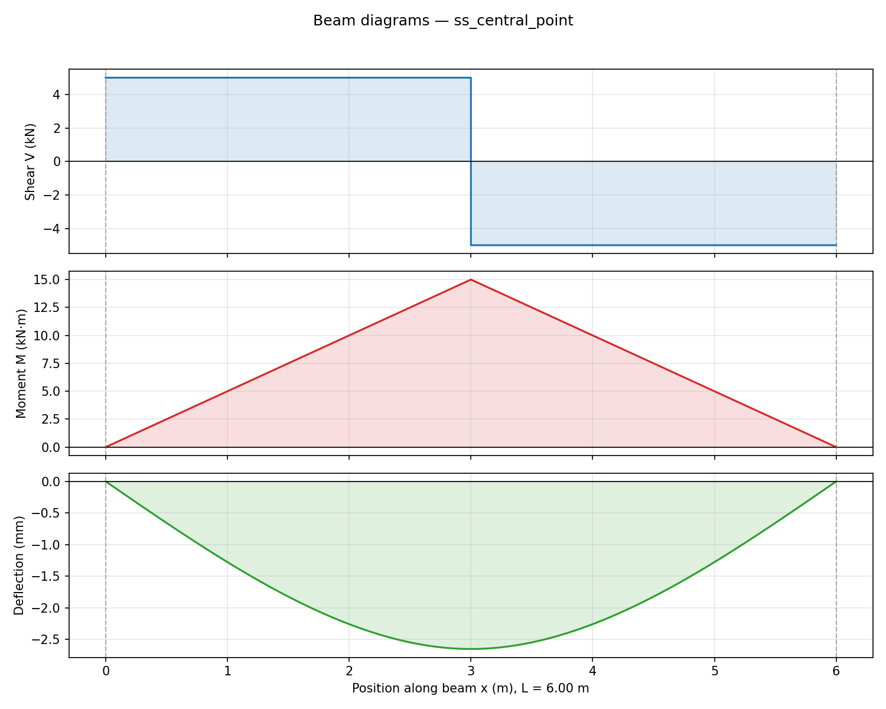

# Beam analysis report — ss_central_point

Span L = 6.000 m; E = 200,000 MPa; Fy = 345 MPa.
Section: **W12x26** (Ix = 8,491.1 cm^4, Sx = 547.3 cm^3, source: AISC Steel Construction Manual, 16th Edition, Table 1-1).

## Supports and loads

| Support | x (m) | Type |
|---|---|---|
| S | 0.000 | pin |
| S | 6.000 | roller |

| Point load | x (m) | P (kN) |
|---|---|---|
| P | 3.000 | 10.000 |

## Reactions

| Support x (m) | Type | R vertical (kN) | M reaction (kN*m) |
|---|---|---|---|
| 0.000 | pin | 5.000 | 0.000 |
| 6.000 | roller | 5.000 | 0.000 |

Equilibrium check: force residual 1.44e-09 kN, moment residual 7.20e-09 kN*m.

## Key results

- Max shear: **5.000 kN** at x = 2.820 m
- Max bending moment: **15.000 kN*m** at x = 3.000 m
- Min bending moment: **0.000 kN*m** at x = 6.000 m
- Max downward deflection: **2.650 mm** at x = 3.000 m

## Stress checks

| Check | Demand | Allowable / capacity | Utilisation | Verdict |
|---|---|---|---|---|
| Bending stress | 27.41 MPa | 227.70 MPa | 0.120 | PASS |
| Shear stress | 2.76 MPa | 138.00 MPa | 0.020 | PASS |
| LRFD flexure | 15.00 kN*m | phi*Mn = 189.28 kN*m | 0.079 | PASS |
| Deflection | 2.65 mm | 16.67 mm (L/360) | 0.159 | PASS |

**Overall verdict: PASS**

## Diagram values (stations every 0.5 m)

| x (m) | V (kN) | M (kN*m) | delta (mm) |
|---|---|---|---|
| 0.00 | 5.000 | 0.000 | 0.000 |
| 0.50 | 5.000 | 2.500 | -0.656 |
| 1.00 | 5.000 | 5.000 | -1.276 |
| 1.50 | 5.000 | 7.500 | -1.822 |
| 2.00 | 5.000 | 10.000 | -2.257 |
| 2.50 | 5.000 | 12.500 | -2.546 |
| 3.00 | 5.000 | 15.000 | -2.650 |
| 3.50 | -5.000 | 12.500 | -2.546 |
| 4.00 | -5.000 | 10.000 | -2.257 |
| 4.50 | -5.000 | 7.500 | -1.822 |
| 5.00 | -5.000 | 5.000 | -1.276 |
| 5.50 | -5.000 | 2.500 | -0.656 |
| 6.00 | -5.000 | 0.000 | 0.000 |

> Sign convention: V and M follow dV/dx = -w and dM/dx = V, M positive when sagging. Deflection positive upward in the table; the reported maximum is the largest downward value. Euler-Bernoulli theory (no shear deformation).
