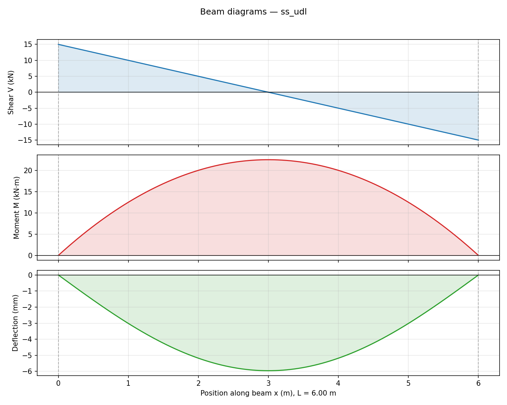

# Beam analysis report — ss_udl

Span L = 6.000 m; E = 200,000 MPa; Fy = 345 MPa.
Section: **W10x30** (Ix = 7,075.9 cm^4, Sx = 530.9 cm^3, source: AISC Steel Construction Manual, 16th Edition, Table 1-1).

## Supports and loads

| Support | x (m) | Type |
|---|---|---|
| S | 0.000 | pin |
| S | 6.000 | roller |

| Distributed load | x1 (m) | x2 (m) | w1 (kN/m) | w2 (kN/m) |
|---|---|---|---|---|
| w | 0.000 | 6.000 | 5.000 | 5.000 |

## Reactions

| Support x (m) | Type | R vertical (kN) | M reaction (kN*m) |
|---|---|---|---|
| 0.000 | pin | 15.000 | 0.000 |
| 6.000 | roller | 15.000 | 0.000 |

Equilibrium check: force residual 4.00e-09 kN, moment residual 3.29e-08 kN*m.

## Key results

- Max shear: **15.000 kN** at x = 0.000 m
- Max bending moment: **22.500 kN*m** at x = 3.000 m
- Min bending moment: **-0.000 kN*m** at x = 6.000 m
- Max downward deflection: **5.962 mm** at x = 3.000 m

## Stress checks

| Check | Demand | Allowable / capacity | Utilisation | Verdict |
|---|---|---|---|---|
| Bending stress | 42.38 MPa | 227.70 MPa | 0.186 | PASS |
| Shear stress | 7.40 MPa | 138.00 MPa | 0.054 | PASS |
| LRFD flexure | 22.50 kN*m | phi*Mn = 186.23 kN*m | 0.121 | PASS |
| Deflection | 5.96 mm | 16.67 mm (L/360) | 0.358 | PASS |

**Overall verdict: PASS**

## Diagram values (stations every 0.5 m)

| x (m) | V (kN) | M (kN*m) | delta (mm) |
|---|---|---|---|
| 0.00 | 15.000 | 0.000 | 0.000 |
| 0.50 | 12.500 | 6.875 | -1.569 |
| 1.00 | 10.000 | 12.500 | -3.018 |
| 1.50 | 7.500 | 16.875 | -4.248 |
| 2.00 | 5.000 | 20.000 | -5.182 |
| 2.50 | 2.500 | 21.875 | -5.764 |
| 3.00 | -0.000 | 22.500 | -5.962 |
| 3.50 | -2.500 | 21.875 | -5.764 |
| 4.00 | -5.000 | 20.000 | -5.182 |
| 4.50 | -7.500 | 16.875 | -4.248 |
| 5.00 | -10.000 | 12.500 | -3.018 |
| 5.50 | -12.500 | 6.875 | -1.569 |
| 6.00 | -15.000 | -0.000 | 0.000 |

> Sign convention: V and M follow dV/dx = -w and dM/dx = V, M positive when sagging. Deflection positive upward in the table; the reported maximum is the largest downward value. Euler-Bernoulli theory (no shear deformation).
